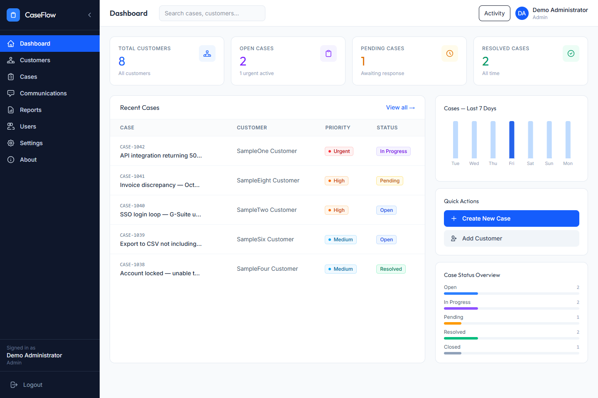
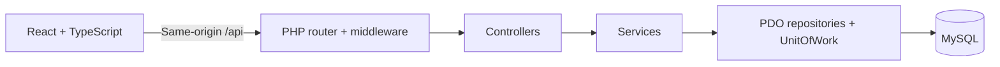

# CaseFlow

**Customer Service & Case Management System**

CaseFlow is a full-stack portfolio project for managing customer records, support cases and communication history. A React and TypeScript interface connects to a PHP API backed by MySQL. The project demonstrates application architecture, relational data modelling, authenticated workflows and role-based access control.

**[Open the live CaseFlow demo](https://caseflow-customer-service-demo.vercel.app/login)** · [Local setup](docs/SETUP.md) · [Verification](docs/VERIFICATION.md)

The public demo is a separate deployed version. No Admin or Support Agent credentials are included in this repository. Use only an intentionally shared read-only demo account to review hosted data.

*Actual application UI with synthetic test fixtures. This is not a production environment.*

## Product tour

| Area | What it demonstrates |
| --- | --- |
| Dashboard | Case summaries and workload visibility |
| Customers | Search, profiles and customer-linked case history |
| Cases | Assignment, priorities, status updates and activity timelines |
| Communications | Conversation records and internal notes |
| Reports | Charts and case metrics |
| Accounts | Session authentication, profile settings and an Admin user directory |
| Demo Viewer | Server-enforced read-only access for portfolio reviews |

## Engineering

- **Frontend:** React 19, TypeScript, React Router, Vite, Tailwind CSS and Recharts.
- **Backend:** plain PHP, PDO and MySQL/MariaDB; a JSON REST-style API with controllers, services and repository contracts.
- **Data integrity:** parameterized queries, relational constraints and transactions with nested savepoints.
- **Access controls:** role checks, CSRF protection, session expiration, login throttling and upload validation.
- **Verification:** routing and component tests, server-render checks, SPA fallback checks, PHP service/transaction tests and database integration checks.

## Repository guide

| Path | Purpose |
| --- | --- |
| `frontend/` | Application UI, routing and frontend tests |
| `backend/` | API, schema and backend tests |
| `docs/SETUP.md` | Local configuration and verification commands |
| `docs/PORTFOLIO.md` | Project description and feature highlights |
| `docs/PRIVACY.md` | Security controls and public-data practices |
| `scripts/export-showcase.ps1` | Create an allowlisted source archive |

Start with the [setup guide](docs/SETUP.md). The application requires a configured database and a separately provisioned account; it does not ship production credentials or automatically sign reviewers in.

After configuring the database and account, run `composer install` and `composer serve` in `backend/`; run `npm ci` and `npm run dev` in `frontend/`. Open `http://localhost:8443`.

## Verification and security

From `frontend/`, run `npm run typecheck`, `npm test`, `npm run build` and `npm run api:test`. Database and opt-in browser workflow commands are in the [setup guide](docs/SETUP.md); executed results and limits are in [VERIFICATION.md](docs/VERIFICATION.md).

The repository includes regression tests for routing, sessions, API errors and role restrictions, plus database and browser workflow checks. [Security notes](docs/PRIVACY.md) explain the implemented controls and the shared-workspace authorization model. Use only fictional records in public demos.

## Scope and tradeoffs

CaseFlow is a portfolio application. Workspace data currently loads as one payload; server-side pagination is future work. Accounts are provisioned outside the public API. The schema initializer creates tables but is not a migration system. Communications are recorded, not sent as email. There is no self-service password reset, malware scanning or tenant isolation. Automated tests cover specific behaviors and do not establish load capacity or complete security assurance.

The linked frontend is on Vercel; `frontend/vercel.json` routes API requests to Railway. Deployment checks and their scope are documented in [VERIFICATION.md](docs/VERIFICATION.md). The repository contains no hosting secrets.

## License

Copyright (c) 2026 haeythamM. All rights reserved. Original project code remains proprietary; see [LICENSE](LICENSE). Dependency licenses remain with their respective owners.
